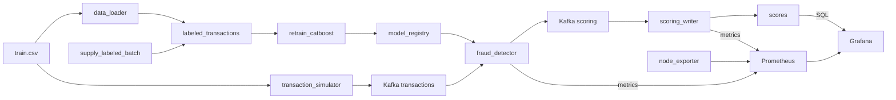

# Антифрод: поток транзакций, скоринг и переобучение

Учебный проект обнаружения мошеннических транзакций. Kafka несёт непрерывный поток событий, CatBoost скорит их текущей моделью, а Airflow по расписанию дописывает размеченные месяцы и переобучает модель. Prometheus и Grafana показывают скорость обработки, распределение скоров и смену версии модели.

Датасет можно найти [здесь](https://www.kaggle.com/competitions/teta-ml-1-2025/data). Путь задаётся переменной `TRAIN_DATA_CSV`.

---

## Архитектура



| Сервис | Описание                                                                                                                                                        |
|--------|-----------------------------------------------------------------------------------------------------------------------------------------------------------------|
| **Kafka** | Шина сообщений между симулятором потока, скорингом и записью результатов                                                                                        |
| **Zookeeper** | Управление кластером Kafka                                                                                                                                      |
| **Kafka UI** | Просмотр топиков `transactions` и `scoring`                                                                                                                     |
| **transaction_simulator** | Бесконечно шлёт в `transactions` случайные строки CSV. У каждой новый `transaction_id` и `transaction_time`, равный текущему моменту, формат `YYYY-MM-DD HH:MM` |
| **fraud_detector** | Препроцессинг и инференс CatBoost. Перед каждым сообщением читает `/models/latest.txt` и подхватывает `my_catboost_<версия>.cbm` без перезапуска                |
| **scoring_writer** | Читает топик `scoring` и пишет `score`, `fraud_flag` и `model_version` в PostgreSQL                                                                             |
| **PostgreSQL** | Витрина `labeled_transactions`, состояние окна `training_state` и таблица `scores`                                                                              |
| **data_loader** | При старте один раз загружает весь CSV в витрину и собирает исходное окно обучения: январь–март 2019                                                            |
| **airflow** | Два DAG каждые 5 минут: поставка нового размеченного месяца и переобучение CatBoost                                                                             |
| **Prometheus** | Собирает метрики `fraud_detector` (`:8000`), `scoring_writer` (`:8001`) раз в секунду, Node Exporter - каждые 5 секунд                                          |
| **Grafana** | Дашборды скоринга, записи в БД, системных метрик и аналитики из PostgreSQL. Смена версии модели отмечена интервалом около 30 секунд с именем новой версии       |
| **Node Exporter** | Системные метрики хоста контейнеров: CPU, память, сеть, диск                                                                                                    |

Общий том `model_registry` смонтирован в Airflow как `/opt/airflow/models` и в `fraud_detector` как `/models`. Логика задач вынесена в `pipeline/`. Файлы в `dags/` только связывают задачи.

---

## Структура проекта

```
.
├── fraud_detector/           # Онлайн-скоринг
├── transaction_simulator/    # Непрерывная поставка транзакций в Kafka
├── scoring_writer/           # Запись скоров в PostgreSQL
├── data_loader/              # Первичная загрузка размеченной витрины
├── dags/
│   ├── retrain_catboost.py   # DAG переобучения
│   └── supply_labeled_batch.py
├── pipeline/
│   ├── db.py                 # Подключение к витрине и training_state
│   ├── retrain/              # Функции задач переобучения
│   └── supply/               # Функции задач поставки месяца
├── airflow/                  # Образ Airflow с CatBoost
├── prometheus/prometheus.yml # Источники метрик
├── grafana/                  # Datasource, provisioning и дашборды
├── docker-compose.yaml
├── .env.example
└── README.md
```

---

## Что происходит после запуска

1. `data_loader` копирует `TRAIN_DATA_CSV` в `labeled_transactions` и сохраняет окно января–марта 2019. Повторный старт без `down -v` витрину не перезаливает.
2. `transaction_simulator` каждые 0.1 секунды отправляет в Kafka случайную транзакцию с текущим временем.
3. `fraud_detector` скорит поток моделью из общего каталога. До первого переобучения версия — `initial`: в каталог копируется модель из образа.
4. `scoring_writer` складывает результат в `scores`, включая `model_version`.
5. DAG `supply_labeled_batch` каждые 5 минут берёт из витрины 100 тысяч случайных строк, переносит их время в следующий календарный месяц и дописывает батч. Наблюдения старше трёх лет относительно самого нового месяца удаляются.
6. DAG `retrain_catboost` каждые 5 минут забирает следующий месяц витрины, начиная с апреля 2019, сдвигает трёхмесячное окно, учит CatBoost и публикует `my_catboost_<timestamp>.cbm`.

Переобучение и поставка идут по разным указателям месяца. `retrain_catboost` читает исторические месяцы с апреля 2019. `supply_labeled_batch` каждый раз создаёт месяц после максимальной даты витрины, первый такой месяц — апрель 2020. Окно обучения ещё долго не доходит до этих батчей, и очистка трёх лет его не затрагивает.

Оба DAG можно запустить вручную в Airflow, не дожидаясь расписания. Если очередного месяца в витрине ещё нет, задачи переобучения помечаются как skipped.

---

## Технологии

- **Python 3.11**
- **ML**: CatBoost, pandas, numpy
- **Kafka**: потоковая обработка данных
- **PostgreSQL**: витрина размеченных данных и результаты скоринга
- **Airflow 2.10**: поставка месячных батчей и переобучение модели
- **Prometheus / Grafana**: сбор и визуализация метрик скоринга и хоста
- **Docker / Docker Compose**: оркестрация микросервисов

---

## Как запустить проект

### 1. Клонируйте репозиторий

```bash
git clone https://github.com/macaroni888/MLOps_HW5.git
cd MLOps_HW5
```

### 2. Создайте `.env` файл

```bash
cp .env.example .env
```

В `TRAIN_DATA_CSV` укажите путь к размеченному `train.csv` на вашей машине.

В `.env` также задаются пользователь и пароль для чтения результатов из Grafana:

```dotenv
GRAFANA_POSTGRES_USER=grafana_reader
GRAFANA_POSTGRES_PASSWORD=grafana_readonly_local
```

Эти переменные уже есть в `.env.example`. Писатель автоматически создаёт пользователя с доступом на чтение таблицы `scores`, а Grafana подключает источник PostgreSQL. Это отдельные учётные данные БД, не пароль входа в Grafana.

### 3. Запустите контейнеры

```bash
docker compose up --build
```

Нужны [Docker](https://docs.docker.com/engine/install/) и Docker Compose. Первый запуск скачивает образы и загружает витрину, это занимает несколько минут. Завершение `data_loader` и `kafka-setup` со статусом `Exited (0)` нормально: это одноразовые задачи.

## Доступные сервисы

| Сервис | URL |
|--------|-----|
| **Kafka UI** | http://localhost:8080 |
| **Airflow** | http://localhost:8081 (`admin` / `admin`) |
| **PostgreSQL** | `localhost:5432`, база `fraud_db` |
| **Prometheus** | http://localhost:9090 |
| **Grafana** | http://localhost:3000 (`admin` / `admin`) |

При первом входе Grafana предлагает сменить пароль. Кнопка Skip оставляет `admin` / `admin`.

Пользователь и пароль Postgres задаются в `.env` (`fraud_user` / `fraud_pass` в шаблоне).

Посмотреть витрины из контейнера:

```bash
docker compose exec postgres psql -U fraud_user -d fraud_db
```

---

## Таблицы PostgreSQL

Таблица `scores`:

| Поле | Тип | Описание |
|------|-----|----------|
| id | SERIAL | Уникальный ID |
| transaction_id | TEXT | Идентификатор транзакции |
| score | FLOAT | Вероятность мошенничества, порог 0.5 |
| fraud_flag | INT | 1, если score больше 0.5, иначе 0 |
| model_version | TEXT | Версия CatBoost, которая посчитала скор |
| us_state | TEXT | Штат исходной транзакции |
| merch | TEXT | Продавец |
| cat_id | TEXT | Категория продукта |
| processed_at | TIMESTAMPTZ | Время завершения расчёта скора в UTC, до отправки в Kafka |
| created_at | TIMESTAMP | Время записи |

`labeled_transactions` — витрина размеченных транзакций. `training_state` хранит границы трёхмесячного окна обучения и месяц следующего батча.

Последние скоры:

```sql
SELECT transaction_id, score, fraud_flag, model_version, created_at
FROM scores
ORDER BY created_at DESC
LIMIT 20;
```

Модели, которые опубликовал DAG:

```bash
docker compose exec airflow ls -la /opt/airflow/models
```

---

## Как смотреть демонстрацию

1. В Kafka UI топик `transactions` пополняется каждые 0.1 секунды, топик `scoring` — ответами модели.
2. В Airflow откройте `supply_labeled_batch` и `retrain_catboost`. Кнопка Trigger запускает прогон сразу.
3. После публикации модели новые сообщения в `scores` получают свежий `model_version`.
4. В Grafana откройте «Обработка транзакций» и «Запись результатов». На графиках скоров смена модели видна как отметка примерно в 30 секунд с подписью `model_version`. «Системные метрики» показывают CPU, память, сеть и диск.

### Очистка

`docker compose down -v` удаляет контейнеры вместе с витриной, окном обучения, реестром моделей, состоянием Airflow и томами Prometheus и Grafana. Следующий запуск снова загрузит CSV.

---

## Метрики

Prometheus опрашивает скоринг и писатель каждую секунду, Node Exporter — каждые 5 секунд. Все сервисы находятся в сети `ml-scorer`. Метки `service` различают обработку, запись и инфраструктуру.

| Метрика | Тип | Значение | Где используется                                                                                                                                                                             |
|---|---|---|----------------------------------------------------------------------------------------------------------------------------------------------------------------------------------------------|
| transactions_total | Counter | Подтверждённые отправки в Kafka | «Обработка транзакций» / «Скорость потока», «Доля неуспешных обработок» <br/> «Аналитика транзакций» / «Скорость общего потока · Prometheus»                                                 |
| transaction_processing_seconds | Summary | Время попытки обработки в секундах; сохранена для совместимости, доступны sum/count | Отдельного графика нет. Prometheus / запросы `transaction_processing_seconds_sum` и `transaction_processing_seconds_count`                                                                   |
| transaction_processing_duration_seconds | Histogram | Длительность всех попыток, включая Kafka | «Обработка транзакций» / «Время обработки»                                                                                                                                                   |
| transaction_processing_errors_total{stage} | Counter | Ошибки decode, inference или delivery | «Обработка транзакций» / «Доля неуспешных обработок»                                                                                                                                         |
| transaction_last_success_timestamp_seconds | Gauge | Время последней подтверждённой отправки, инициализируется временем запуска | Отдельного графика нет. Grafana Alerting / «Fraud: поток остановился»                                                                                                                        |
| fraud_score | Histogram | Распределение успешно отправленных скоров | «Обработка транзакций» / «Распределение скоров во времени»                                                                                                                                   |
| fraud_ratio | Gauge | Доля score > 0,5 среди успешных результатов с запуска | «Обработка транзакций» / «Доля фрода»                                                                                                                                                        |
| model_version_updates_total{version} | Counter | Число переходов на версию модели; первая загрузка не считается переходом | Отдельного графика нет. Prometheus / запрос `model_version_updates_total`                                                                                                                    |
| model_reload_timestamp_seconds{version} | Gauge | Время последнего перехода на версию | «Обработка транзакций» / «Время обработки», «Распределение скоров во времени»<br/> «Запись результатов» / «Время записи в базу», «Распределение записанных скоров» — отметки «Модель переключена» |
| scorings_total | Counter | Успешные записи в БД | «Запись результатов» / «Скорость записи в базу»                                                                                                                                              |
| scoring_db_write_seconds | Summary | Время записи и commit в секундах | «Запись результатов» / «Время записи в базу»                                                                                                                                                 |
| fraud_detected_total | Counter | Записанные результаты с fraud_flag = 1 | «Запись результатов» / «Число выявленного фрода»                                                                                                                                             |
| scoring_fraud_score | Histogram | Распределение записанных скоров | «Запись результатов» / «Распределение записанных скоров»                                                                                                                                     |
| node_cpu_seconds_total | Counter | Использование CPU по режимам | «Системные метрики» / «CPU»                                                                                                                                                                  |
| node_memory_MemAvailable_bytes, node_memory_MemTotal_bytes | Gauge | Доступная и общая память | «Системные метрики» / «Память»                                                                                                                                                               |
| node_network_receive_bytes_total, node_network_transmit_bytes_total | Counter | Сетевой трафик | «Системные метрики» / «Сеть»                                                                                                                                                                 |
| node_disk_read_bytes_total, node_disk_written_bytes_total | Counter | Дисковый ввод-вывод | «Системные метрики» / «Диск»                                                                                                                                                                 |
| node_filesystem_avail_bytes, node_filesystem_size_bytes | Gauge | Свободное место и размер файловой системы | Отдельного графика нет. Prometheus / запросы `node_filesystem_avail_bytes` и `node_filesystem_size_bytes`                                                                                    |
| up | Gauge | Успешность сбора метрик Prometheus | Отдельного графика нет. Prometheus / запрос `up` или страница Targets                                                                                                                        |

Для Histogram экспортируются суффиксы `_bucket`, `_sum`, `_count`, для Summary - `_sum` и `_count`. Счётчики сбрасываются при перезапуске процесса; `rate` учитывает сбросы. БД хранит историю между перезапусками.

Дополнительный показатель - доля неуспешных обработок за последние 5 минут. Он вычисляется из собственного счётчика `transaction_processing_errors_total` и счётчика успешных результатов `transactions_total`. График «Доля неуспешных обработок» находится внизу дашборда «Обработка транзакций».

```promql
sum(rate(transaction_processing_errors_total[5m]))
/
(sum(rate(transactions_total[5m])) + sum(rate(transaction_processing_errors_total[5m])))
```

Grafana отображает долю в процентах и автоматически подбирает верхнюю границу оси. При отсутствии завершённых попыток в окне доля не определена, линия имеет разрыв. В знаменатель входят и успешные, и неуспешные попытки, а не только успехи.

Метрика помогает отличить уменьшение входного потока от ошибок обработки и заметить сбои после обновления модели. Учитываются ошибки разбора сообщения, предсказания и отправки результата. Ошибки опроса Kafka и аварийное завершение процесса сюда не входят.

---
## Как проверить рост метрик
1. Prometheus Targets. Источники fraud_detector, scoring_writer и node должны иметь статус UP.
2. Метрики скоринга (http://localhost:8000). `transactions_total` должна расти при обновлении страницы.
3. Метрики записи (http://localhost:8001). `scorings_total` должна расти при обновлении страницы.
4. Запрос с именем метрик в Prometheus - в окне Graph будет график с изменением
5. Так же аггрегаты по метрикам есть в Дашборде


---

## Дашборды

Источники Prometheus Metrics и PostgreSQL Scores и четыре дашборда создаются автоматически из файлов репозитория. На дашборде обработки к обязательным показателям добавлена доля ошибок.

| Дашборд | Прямая ссылка | Содержание |
|---|---|---|
| Обработка транзакций | http://localhost:3000/d/fraud-detection | Скорость потока, среднее/p95 времени обработки, доля фрода, распределение скоров во времени, доля неуспешных обработок; аннотации смены модели |
| Запись результатов | http://localhost:3000/d/scoring | Скорость и время записи, число выявленного фрода с запуска писателя, распределение записанных скоров |
| Системные метрики | http://localhost:3000/d/node-metrics | CPU, память, сеть, диск |
| Аналитика транзакций | http://localhost:3000/d/transaction-analytics | Число скоров и доля фрода по версии, общая скорость потока из Prometheus, TPS и плотность скоров с фильтрами, barplot по категориям последних 1000 записей |

Дашборды обновляются каждые 5 секунд, начальный диапазон — последние 15 минут. После запуска подождите 1–2 минуты.

### Фильтры и расчёты

На «Аналитике транзакций» есть фильтры: `Штат` (`us_state`) и `Продавец` (`merch`). Можно выбрать несколько значений или All. Значения читаются из PostgreSQL при открытии дашборда. Оба фильтра одновременно применяются только к TPS и плотности скоров. Выбранные значения экранируются форматированием Grafana `sqlstring`. Для All задан SQL-литерал `'__all'` с одинарными кавычками: Grafana подставляет Custom all value без дополнительного экранирования.

- Плотность: 20 интервалов шириной 0,05. Высота столбца равна `число в интервале / (число выбранных транзакций × 0,05)`. Если выборка пуста, панель показывает отсутствие данных.
- TPS: число выбранных результатов по `processed_at` в интервалах 10 секунд, делённое на длительность интервала. Для краёв диапазона используется фактическая видимая длительность. Это скорость уже сохранённых результатов по времени их обработки, поэтому данные приходят с задержкой записи.
- Версии: учитывается диапазон времени записи `created_at`, фильтры штата/продавца не применяются. Рядом видна общая скорость потока из Prometheus, ниже - TPS выбранного потока.
- Категории: сначала выбираются последние 1000 записанных строк по убыванию `id`, затем для каждой `cat_id` вычисляется среднее `fraud_flag`. Если строк меньше 1000, используются все, фильтры штата/продавца не применяются.

### Обновление существующих данных

Писатель автоматически добавляет `us_state`, `merch`, `cat_id`, `processed_at` и индексы. Фильтруемые панели начнут заполняться новыми сообщениями после пересборки скоринга и писателя. Сравнение версий продолжает учитывать старые записи.


## Алерты Grafana

Правила лежат в `grafana/provisioning/alerting/rules.yaml` и создаются при старте.

| Правило | Условие | Время подтверждения |
|---|---|---|
| Fraud: поток остановился | Прошло больше 120 секунд после последней подтверждённой отправки | Ещё 1 минута |
| Fraud: высокая задержка | p95 за последние 2 минуты выше 0,5 секунды | 2 минуты |

При отсутствии данных правило получает No Data, при ошибке вычисления - Error; эти состояния не маскируются под Normal. При остановке потока p95 может стать неопределённым, основной сигнал в таком случае - алерт потока.

Проверка первого правила:

```bash
docker compose stop transaction_simulator
```

Оставьте Kafka, скоринг, писатель, Prometheus и Grafana включёнными. После обработки накопленных сообщений дождитесь примерно 3 минут и ещё одного цикла оценки. Правило должно пройти Normal → Pending → Firing (Alerting). Затем:

```bash
docker compose start transaction_simulator
```

После первой успешной отправки и следующей оценки алерт вернётся в Normal.

Проверка второго правила без искусственного торможения сервиса:

1. Убедитесь, что поток работает и панель p95 показывает положительное число.
2. В `rules.yaml` только у правила `fraud-latency-high` замените порог `0.5` в `model.conditions.evaluator.params` на `0.0`.
3. Выполните `docker compose restart grafana`. После двух минут превышения и цикла оценки правило станет Firing.
4. Верните порог `0.5` и снова выполните `docker compose restart grafana`. Если обычный p95 ниже 0,5 секунды, правило вернётся в Normal. Если выше — сначала разберите нагрузку; рабочий порог не следует поднимать только ради зелёного статуса.

Provisioned-правила редактируются в файлах, не в UI. Проверка снижением порога подтверждает работу вычисления и переходов состояния, но не является нагрузочным тестом.

